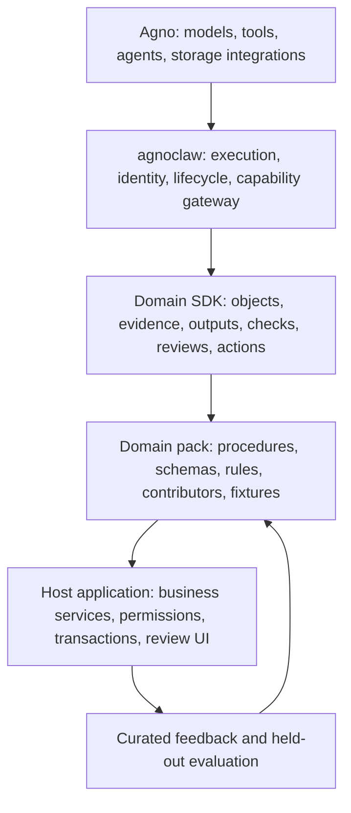

# Domain harnesses: research and platform roadmap

Research checked 2026-10-18. This is a qualitative sample of primary sources,
not a census or market-share estimate. Product descriptions are company claims;
the architecture recommendations below are our synthesis.

## What the YC evidence supports

There is clear activity around agents that own particular business workflows.
The claim that the latest YC batch is **almost entirely domain harnesses** is not
established by this research. Fall 2026 is still underway; YC schedules its Demo Day
for December 2. Public listings and launch announcements are a changing sample,
and neither an AI tag nor a vertical product demonstrates its internal architecture.
[YC's 2026 schedule](https://www.ycombinator.com/blog/2026-demo-days/).

Recent concrete examples:

| Company / batch | Published focus | Design lesson inferred for agnoclaw |
|---|---|---|
| [Qlo / Summer 2026](https://www.ycombinator.com/companies/qlo) | Commercial underwriting operations, with shared accounts, rules, documents, permissions and workflow state | Objects, policy versions, delegated authority and review state matter together |
| [Async / Summer 2026](https://www.ycombinator.com/companies/withasync) | Work for law firms, clinics and real-estate businesses, including legacy systems | Procedure knowledge and reliable application actions are part of the product |
| [FullSeam / Winter 2026](https://www.ycombinator.com/companies/fullseam) | Accounting agents operating existing AP/AR tools | Reconciliation, transaction identity and auditable changes need domain contracts |
| [Taiga / Spring 2026](https://www.ycombinator.com/companies/taiga) | Medical billing | Patient/claim identity and payer-specific evidence require specialist adapters |
| [Walter / Spring 2026](https://www.ycombinator.com/companies/walter) | Manufacturing back-office work in existing ERP and communication tools | Order semantics, exceptions and verification after UI actions cannot be generic prompts |
| [Peer / Summer 2026](https://www.ycombinator.com/companies/peer) | Freight quoting, carrier selection, shipment tracking and exceptions | Time-sensitive state and external commitments need explicit action boundaries |
| [Whitespace / Summer 2026](https://www.ycombinator.com/companies/whitespace) | Distribution operations, including order processing and inventory planning | Corrections can inform evaluation, but promotion into policy needs explicit control |

The terminology is also becoming explicit: Autumn's
[Harness Lead job description](https://www.ycombinator.com/companies/autumn-ai/jobs/gj5dGt0-harness-lead)
describes building research agents for people and companies, choosing tools and
evaluating improvements. That is evidence of a harness engineering role, not a
count of YC companies or proof that they would buy a shared SDK.

## What domain specificity actually adds

A useful domain harness defines what the agent works on, what counts as evidence,
which procedures apply, what it may change, and how success is established. Prompt
instructions alone leave these contracts implicit. A company-specific layer adds
local policy, schemas, data permissions and review responsibilities on top of the
industry's common concepts.

The following are candidate high-value domains, not a statistical ranking. Each
row describes proposed engineering requirements, not verified capabilities of a
particular vendor or legal/regulatory guidance.

| Domain | Objects and evidence | What makes verification and action special | Useful first workflow |
|---|---|---|---|
| Accounting / finance operations | Invoice, ledger entry, payment; bank record and receipt | Balanced amounts, currency/period, reconciliation and duplicate-payment prevention | Prepare a reconciled invoice proposal for approval |
| Insurance | Submission, policy, endorsement, claim; loss history and policy wording | Effective dates, coverage exclusions, underwriting appetite and binding authority | Assemble submission evidence and route exceptions |
| Healthcare administration | Patient, appointment, claim; authorized records and payer responses | Correct patient/encounter, payer-specific requirements and sensitive access | Prepare billing or authorization work for specialist review |
| Legal operations | Matter, clause, filing; source documents and authorities | Jurisdiction, version, privilege boundaries, traceable citations and professional sign-off | Review a contract against a firm playbook |
| Investment diligence / Clarion | Deal, company, artifact; dated document renditions | Financial period/unit, source independence, conflicting claims and human judgment | Evidence-backed field proposals and typed analytical artifacts |
| Manufacturing / procurement | Order, part, supplier, inventory; specifications and ERP records | Unit conversion, part revisions, tolerances, approved suppliers and stale stock | Validate an order and propose an ERP update |
| Logistics / trade operations | Shipment, carrier, booking; status events and transport documents | Time windows, changing status, capacity and external booking commitments | Resolve shipment exceptions with approved actions |
| Construction / property operations | Asset, project, RFI, change order; drawings and inspection records | Drawing revision, site location, contract scope and change authority | Assemble a documented change-order review |
| Customer support / commerce | Customer, ticket, order; interaction history and entitlement | Identity, refund policy, prior credits and irreversible communications | Resolve a bounded support case with verified refunds |
| Security / IT operations | Identity, asset, alert, incident; logs and configuration snapshots | Adversarial input, blast radius, containment approval and recovery | Investigate an alert and propose a reversible response |
| Science / lab operations | Sample, protocol, experiment; instruments and observations | Units, calibration, reproducibility, lineage and physical safety | Assemble reproducible experiment records for review |

Prioritize workflows with repeated expensive work, accessible authorized data,
checkable outputs, an accountable reviewer and a bounded write surface. A domain
with no reliable outcome signal is a poor first automation target even when its
language is highly specialized. Among these candidates, diligence is the best
first integration here because Clarion supplies a real adopter; invoice handling
provides a second, independently testable example of arithmetic and action control.

## The reusable architecture

The layers express ownership, not a second execution loop. Agno remains responsible
for model execution. agnoclaw supplies reusable bounded contracts and connects them
to its governed capability executor. A domain pack supplies expert definitions and
adapters. The application authenticates users and owns business state and commits.

An `interface` package should grow from real consumers of typed outputs, pending
reviews and evidence locations. The current `interaction` module is the portable
request/decision contract. A universal UI renderer, chat replacement and business
ORM would be premature. Similarly, procedures are declarations used by hosts; they
are not an automatically enforced DAG or a replacement for Agno workflows.

## Release and roadmap gates

1. **0.14 preview — implemented.** Scoped objects, source-bound text evidence,
   typed outputs, versioned checks, reviewed-action contracts, procedure and pack
   declarations, bounded context, feedback fixtures, decision rules and inference
   routing hints. The offline example exercises real SQLite writes and replay.
2. **Clarion adoption — partly implemented.** Opt-in source-evidence/review and
   typed-input adapters are in the companion branch. Next certify the complete
   agnoclaw version pair, connect one real action with authoritative review lookup
   and atomic revision checks, and add field-specific semantic verification.
3. **Developer usability — acceptance gate.** A second independent adopter builds
   a domain pack using public APIs only. Measure setup effort, repeated adapter
   code and failure diagnosis. Extract storage/review/interface utilities only
   where both adopters establish a shared contract.
4. **Stable SDK — acceptance gate.** Versioned serialization and migration policy,
   compatibility tests for maintained Agno versions, domain evaluation datasets,
   connector contract tests and documented authority/recovery responsibilities.
5. **Hosted platform — conditional.** Add managed execution, tenancy operations,
   review storage or a pack registry only if independent adopters repeatedly need
   them. An SDK is useful before a hosted platform is justified.

For each iteration, record the proposed domain failure, source of truth, required
check, allowed action, reviewer, evaluation fixture and measurable outcome. Compare
task completion, unsupported acceptance, review burden, latency and cost. Contract
tests prove mechanisms; they do not establish clinical, financial or legal accuracy.

## Decision models and fast inference

Keep three concepts separate: deterministic business rules, statistical prediction,
and model reasoning depth. The preview's unique-hit decision table gives explicit
rules and abstains on zero or multiple matches. It is inspired by decision modeling,
not a DMN engine. A forecast, classifier or optimizer can be a host capability with
versioned inputs, outputs and evaluation data; it need not be an LLM.

Fast inference can help classification, routing and simple extraction once held-out
domain evaluations support it. The optional routing policy requires an evaluated
fast tier and bounded escalation to deliberate inference or human review. It does
not select or call models automatically, and a routing decision grants no write
permission. Begin with a deliberate baseline and compare false acceptance and
review burden before making speed the default. Learned sequential policies or
reinforcement learning need environment/reward evidence beyond this preview.

The SDK's [research ledger](domain-sdk.md#research-ledger--2026-10-18) links the
primary technical sources behind evidence selectors, decision modeling, context,
routing and evaluation. Domain-specific formulas, policy rules and training data
remain in adopter-owned packages.
