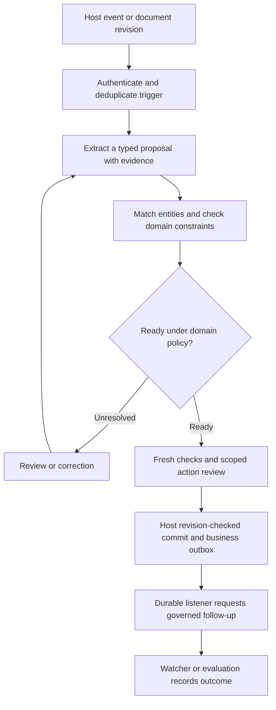

# Domain objects and behavior contracts

Design notes, 2026-10-19. The [framework roadmap](framework-roadmap.md) is the
implementation plan. Proposed capabilities are distinguished from existing APIs.

A domain framework connects typed objects, explicit relationships, evidence-backed
proposals and reusable behavior. Hosts retain storage, authorization and business
transactions. The library supplies validation, composition, inspection and execution
contracts.

## Objects, links and identity

A proposed entity definition names a business kind and its schema reference. A proposed
relation definition names its source/target kinds, direction, multiplicity and optional
edge schema. An `ObjectLink` is one instance of that relationship. A relation definition
must not silently create database joins or links merely because two fields have the
same value. A host adapter can resolve foreign keys or supply explicit edges.

Keep five questions distinct:

| Question | Identity involved |
|---|---|
| Which logical object is this? | Stable tenant-scoped `ObjectId` |
| Which exact state was checked? | Revision-bound `ObjectRef` and content digest |
| Could two records describe the same real entity? | Namespaced external identifiers and a domain matching policy |
| Is this a retry of the same requested effect? | `OperationIdentity`, including intent comparison |
| What should a person see? | Display title, label and presentation hints |

Names can change, external identifiers can be reused, and two documents about one
company are still distinct documents. Content hashes also answer a different question
from real-world identity. Do not normalize or deduplicate these interchangeably.

Relation validation has two scopes. Checking endpoint kinds and edge shape is local;
checking existence, uniqueness or maximum cardinality requires authoritative host
state. A partially loaded graph cannot prove there are no other edges. Reports must
identify incomplete scope, and writes must enforce relevant constraints transactionally.
Relationship meaning and evidence support also remain different: a link between a
document and company does not prove every claim in that document.

Future object-read ports should require tenant, model and authorized object scope,
with bounded traversal and projection. Hosts enforce access on every traversal;
a schema or relation declaration supplies no permission. There is no need to introduce
a graph query language into the core SDK.

## Four kinds of conflict, four different mechanisms

1. **Definition conflict:** two packs assign incompatible meanings to the same typed
   reference. Resolve through explicit overlays and a reviewed catalog diff.
2. **Request conflict:** a repeated operation key carries different intent. Existing
   `OperationIdentity` can classify it; the host must reserve/compare atomically.
3. **Concurrent edit conflict:** a proposal and current state both change the same
   field relative to a base. Existing `ChangeSet` exposes a three-way structural merge.
4. **Semantic conflict:** records may describe different entities, or sources disagree
   about a fact. This needs domain policy, evidence and possibly human adjudication.

Finding candidate matches and selecting preferred values are separate operations.
A generic SDK can standardize candidates, reasons and review results;
it cannot decide universally that the newest, largest or most frequent value is true.

For example, two revenue figures may concern different periods, currencies or accounting
bases. Preserve source assertions, units, effective time and the time observed. A host
can derive a preferred projection under a named policy without erasing competing
evidence. Matching confidence is not authorization to merge, and copying a claim across
sources does not create independent corroboration.

A proposed entity merge must explain aliases, references to the old IDs, affected links,
revision checks and audit history. It is a governed host action, not a side effect of
deduplication. Reversing a merge can require a compensating operation; do not promise
generic undo by restoring an old JSON snapshot.

## Proposal processing and reactions

This is a proposed Clarion-shaped sequence using existing foundations. It is not a
claim that agnoclaw already provides an end-to-end workflow engine for these steps.

Schema checks may run before matching, and business constraints may run again on the
final resolved proposal. The exact order belongs to the domain procedure. A pending
review, rejected proposal, checker error and successfully committed object are distinct
states. An asynchronous acknowledgement means accepted work, not a finished effect.

Proposed trigger bindings should declare the event schema, source and event identity,
target procedure/workflow version, applicability filter, actor delegation and concurrency
scope. Repeated delivery of one event differs from a new event about the same object.
Track causation and impose bounds on reaction chains; an object update must not trigger
an unlimited update loop. Decide explicitly whether irrelevant field changes are ignored,
bursts are coalesced, or every revision must be processed.

Hooks and observers need different failure semantics:

| Extension | Contract to expose |
|---|---|
| Policy hook before dispatch | Ordered, bounded, fails closed; any revised proposal needs fresh checks/review |
| Transform | Declared input/output types, attributed transformation, new content digest |
| Progress observer | Bounded best-effort delivery and cancellation; no business authority |
| Durable listener after commit | Host transaction/outbox, consumer identity, checkpoint, retries and idempotent effects |
| Reconciliation observer | Read external state after an uncertain effect; never blindly repeat the mutation |

A synchronous post-hook is not a transactional after-commit listener. Its failure
cannot undo an already completed remote effect. The existing runtime outbox and
Clarion's business outbox have different transaction owners; expose adapters and
correlation rather than imply a shared atomic commit. Registrations belong to an
explicit host instance, with unsubscribe/close and shutdown behavior.

## Interfaces, decision rules and model routes

A reusable interface defines inputs and outputs independently of its implementation.
For
agnoclaw, resolve and inspect the selected implementation before obtaining its approval.
Pin both contract and implementation; an updated tenant override must not change an
already approved action. Report missing or ambiguous bindings rather than silently
choosing a default effectful implementation. Reuse `CapabilitySpec`, the existing
registry and `Action`'s actual-capability-digest guard.

Business call interfaces and human interaction affordances are separate. A typed
question, evidence comparison or approval request should be renderable through Clarion's
web channel or a test adapter, with explicit fallback when a channel cannot present it.
Neither channel support nor schema compatibility establishes execution permission.

Preserve the existing decision semantics: `DecisionTable` returns `NO_MATCH`,
`CONFLICT` or `ERROR` unless exactly one rule decides. Preserve that behavior. Any future
priority or aggregation mode needs explicit semantics, a versioned definition and tests
for overlaps, gaps and boundaries.

An optional decision component can be a deterministic table, statistical predictor or
model-backed recommendation. Give it typed inputs/results and reproducible provenance:
policy/model build, source snapshot, input digest, matched rules when available, and
the checks that accepted or rejected the result. Do not present model-generated reasons
as proof. `InferencePolicy` already supplies bounded fast/deliberate/review routing
hints; extending its evaluation and manifest bindings is more useful than requiring
another model framework. Fast-path admission should use domain fixtures, abstention and
error rates, latency, cost and review burden. A route result never authorizes an action.

## Concrete Clarion DX

Consider a company document proposing an updated metric and a relationship to a deal.
The intended developer experience is:

1. Define the metric's schema, entity/relation meanings, extraction skill, evidence
   checks, applicability rules and fixtures in one domain pack.
2. Resolve it offline. Diagnostics identify bad schema fields, unresolved references,
   incompatible overlays and missing host bindings with their source paths.
3. Bind Clarion's authorized object reads, workspace provider, event bus and business
   write capability through adapters. Clarion keeps its finance policy and transactions.
4. Receive a typed proposal carrying source/revision evidence. Distinguish a new period
   from a contradictory value, and a new document from a duplicate event.
5. Present an attributed comparison through the channel contract. A stale review or
   changed company revision requires refreshed validation before the host commits.
6. Consume the committed event through Clarion's outbox, run an applicable watcher and
   capture attributed feedback. A correction can propose an evaluation fixture; it does
   not automatically retrain a model or promote new policy.

The extraction candidates are Clarion's schema-reference and overlay validation,
skill metadata binding, workspace snapshot providers, channel conformance and watcher
result contracts. Their source paths are inventoried in the
[framework roadmap](framework-roadmap.md#what-can-come-upstream-from-clarion).
This research does not migrate those services or change Clarion's production pin.

## Changes to the implementation sequence

Keep the existing roadmap order, with these sharper deliverables:

- **Catalog first:** resolve typed definition references and retain origin/digest;
  include entity/relation descriptors in the schema design. Inspection reads inert
  manifests; loading trusted Python implementations is a separate operation.
- **Evolution next:** show dependency impact from a schema/relation change through
  skills, checks, procedures, actions and evaluation fixtures. Classify what can be
  checked locally versus what needs authoritative host state.
- **Evaluations throughout:** add ambiguous matches, conflicting claims, missing inputs,
  decision overlap/no-match, duplicate events and stale reviews to adopter fixtures.
- **Extensions before broad automation:** define scoped hook/listener lifetimes,
  interface binding and reaction semantics before certifying a workflow adapter.

The first catalog milestone should validate an invoice pack and a Clarion typed-output
pack without network calls or model credentials, return all actionable reference errors,
and explain changed dependencies without executing callbacks. The later reaction
milestone must demonstrate duplicate delivery, recursive-trigger bounds, cancellation,
slow consumers and a crash between business commit and delivery. Neither milestone
requires a data ingestion platform or a new storage engine.
