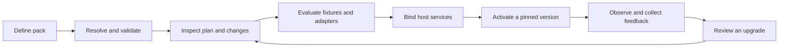

# Embeddable framework and domain-pack roadmap

Design direction, 2026-10-19. This extends the [domain research](domain-harness-research.md)
and [0.15 authoring guide](domain-authoring.md). Unless marked implemented, the
capabilities below are proposed work, not available APIs or release commitments.

Implementation update, 2026-10-20: the 0.15 preview now implements the initial catalog,
schema/relation, evaluation, extension, interface, workspace and sequential workflow
contracts. See [the package authoring guide](domain-packages.md) for runnable public
APIs and the precise host boundaries. Remaining gates below concern broader adapters,
production adoption and certification; they are not claims that those adapters shipped.
The [durability notes](domain-durability.md) apply current Agno and Flue recovery
lessons to domain plans, effects, approvals, events and workspace retention.
The [function-first entry point](domain-quickstart.md) now infers contracts from typed
Python functions, registers checks/examples alongside them and binds request context
once. Explicit declarations remain available as a package needs more control.

The [Domain object and behavior design](domain-model-behavior.md) sharpens this plan with
entity/relation definitions, separate matching and value-resolution policies, reusable
interfaces, trigger semantics and a concrete Clarion proposal-to-commit walkthrough.

## Product direction

agnoclaw should let a developer build, inspect, test, version, embed, and operate a
domain pack. A pack joins schemas, object relationships, evidence rules, skills,
procedures, actions, evaluations, interaction requirements, and workspace resources.
Clarion should increasingly supply its domain definitions and host adapters through
that framework. The opportunity is broader than shortening `ProcedureSpec` constructors.

The primary interface is a Python library. File formats, CLI commands, editors and
services should call the same public APIs. A small application must be able to use
one schema or one evaluation without configuring an entire platform. Importing or
inspecting a pack must not start models, listeners, workers, or infrastructure.

The practical boundary is **shared mechanics plus application-owned semantics**.
agnoclaw can own reference resolution, validation, compatibility diagnostics,
evaluation execution, callback lifetimes and event delivery contracts. Clarion owns
its financial meanings, source permissions, business transactions, canonical entities,
deployment credentials and product experience. Extraction succeeds when Clarion can
delete glue code while retaining those responsibilities explicitly.

## One authoring lifecycle

Resolution should produce an immutable manifest of exact schema, skill, checker,
capability, workflow and workspace versions. Inspection explains where each definition
came from, which override won, what is unresolved, and what an upgrade would invalidate.
Live runs keep their pinned definitions until an explicit, supported migration.
Python callables remain trusted host code; a manifest cannot reproduce arbitrary code
without the corresponding pinned package/build.

## Capability families and existing foundations

These are cohesive responsibilities, not a requirement to create a Python package
for every row. Extend the existing modules before inventing parallel registries.

| Family | Developer experience to provide | Existing foundation / remaining work |
|---|---|---|
| Pack catalog and composition | Discover, resolve, inspect, validate, diff, activate and retire packs; actionable errors with origin paths | Implemented `Domain.compile/validate`, resolved manifests, dependency pins, includes/overrides, aliases and diffs; service activation/retirement remains host-owned |
| Schemas and ontology | Register shapes and entity/relation definitions; resolve references; validate overlays; preview compatibility and migrations | Implemented `Schema.extend`, `Entity`, `Relation`, scoped links and conservative compatibility reports; data migrations remain host-owned |
| Skills and procedures | Bind skill metadata to input/output schemas, checks, capabilities and applicability; derive tool schemas from those bindings | Implemented `SkillBinding`, direct procedure bindings and cross-reference/resource validation over the existing loader |
| Changes and conflicts | Distinguish definition conflicts, data edits, duplicate requests, and contradictory claims; render explicit resolution choices | Implemented definition conflicts, JSON rebasing, request identity, candidate matching and attributed source-priority claim resolution; domain policy remains explicit |
| Evaluations | Run pure checks, replay fixtures, grade outputs/trajectories, test adapters, compare policies/models, measure cost and latency | Implemented `EvaluationSuite`/`PackEvaluation` over exact structured fixtures; advanced graders/paired experiments retain existing runners |
| Workflows | Compose typed steps, branch on results, await reviews, expose progress, cancel and resume with explicit effect semantics | Implemented sequential `Workflow` plans through `CapabilityExecutor`, with persisted-result replay tests; general branching/Agno workflow certification remains |
| Interaction and channels | Declare questions, choices, review/diff requests, evidence views and artifacts; expose unsupported affordances clearly | Implemented typed `Interaction`, `ChannelAdapter`, negotiation and receipts; production transports and Clarion channel migration remain |
| Protocol adapters | Versioned ingress/egress envelopes, schema validation, capability negotiation and compatibility checks | Local channel protocol contracts complement existing lifecycle HTTP and governed MCP; no claim of a new remote protocol deployment |
| Hooks and middleware | Typed interception points with declared ordering, mutation rights, failure policy and cleanup | Implemented instance-scoped `Extensions`, typed policy/transform hooks, bounded callbacks and close/drain/cancel semantics |
| Events and observers | Subscribe to appropriate committed facts, replay by cursor, deduplicate, apply backpressure and inspect delivery failures | Implemented typed events/listeners, consumer identities and `RuntimeListenerExporter`; reuse existing outbox worker and host business receipts |
| Watchers and triggers | Evaluate source changes or scheduled work, report suppression/health, deduplicate triggers and request governed runs | Implemented bounded trigger plans, causation limits and accounted watcher findings; hosts admit/schedule work and promote insights |
| Workspaces | Pin immutable pack resources, layer controlled overrides, isolate session writes, preview refreshes and manage cleanup | Implemented providers, content snapshots, explicit overlays and staged materialization; active pointers, scratch and retention remain host-owned |

## What can come upstream from Clarion

The following assessment comes from reading the local Clarion implementation. Paths
are relative to its repository, mostly under `packages/server/src/clarion/`.
These are extraction candidates, not claims that the entire modules are portable.

| Clarion evidence | Extractable mechanism | Retain in Clarion / adaptation needed |
|---|---|---|
| `domain/schema_ref.py`, `services/ontology_overlay.py`, `_overlay_loaders.py` | Typed references, explicit schema sources, bounded field definitions, parsing, duplicate diagnostics and compilation cache | `deal/company/contact/artifact` vocabulary, finance field meanings, tenant storage; bridge existing reference strings without rewriting persisted data |
| `services/_overlay_presentation.py` | Validating presentation hints against actual schema fields | React components, product layout and user permissions; presentation hints cannot become write authority |
| `agent/skill_registry.py`, `services/skill_frontmatter.py`, `_skill_validation.py` | Strict metadata, output reference resolution, canonical metadata binding and schema/tool consistency checks | Finance artifact names, title policy and composer scopes; extend existing skill metadata compatibly |
| `services/workspace.py`, `_workspace_sync.py` | Source providers, immutable base snapshots, session overlays, refresh and pinned-resume behavior | S3 settings, tenant/deal provisioning, application retention and access rules |
| `channels/contracts.py`, `channels/protocol/v1.py`, `channels/registry.py` | Typed affordances, adapter capability negotiation, ingress/delivery separation and conformance manifests | Clarion-specific navigation/actions, provider authentication, routing and account mapping |
| `watchers/base.py`, `watchers/registry.py` | Detector registration, assessed/suppressed counts, source health, quality versions, reaction bindings and noise-budget reporting | Investment detectors, `InsightService`, SQLAlchemy sessions, entity scopes and promotion policy |
| `services/event_bus.py` | Subscription declarations, consumer diagnostics and replay/idempotency test contracts | Business outbox transaction, ORM, tenant partitioning and worker deployment; adapt this bus rather than copy it into the runtime |
| `scripts/eval_intelligence_corpus.py`, `scripts/eval_document_classifier.py` | Dataset validation, protected cases, slices, abstention/precision/recall reports and explicit rollout gates | Corpus contents, materiality rules, financial graders and deployment thresholds |

Two details argue for careful adaptation. Clarion's workspace freshness digest uses
file size/mtime or object-store metadata; that is a refresh signal, not proof of exact
content. agnoclaw's pack trust already hashes file bytes. Preserve both concepts.
Similarly, Clarion's event bus joins the caller's business transaction; emitting a
runtime event cannot make an unrelated SQL transaction atomic.

Do not move services wholesale and then replace their imports with `Any`. Extract a
small contract, supply an adapter in Clarion, prove behavior against the old path, and
only then remove duplicated implementation. A second domain must exercise the same
contract before application-specific assumptions become a stable SDK promise.

## Schemas and ontology need separate layers

An ontology describes entity kinds, relationship meanings, cardinality, units and
constraints. A schema validates a representation of one of those concepts. A business
database stores instances. They should compose without forcing one ORM or graph store.

Start with Pydantic/JSON Schema and an explicit local schema catalog. Resolve references
from pinned packages/providers; a schema URI must not imply automatic network access.
Keep logical schema identity, authored version, source provenance and exact digest
separate. [JSON Schema's reference model](https://json-schema.org/understanding-json-schema/structuring)
supports identifying reusable schemas independently of their retrieval location.

Schema evolution needs producer/consumer direction: accepting older data and producing
data older consumers can read are different compatibility questions. Adding a required
field, narrowing an enum, changing units, or altering a custom validator needs explicit
impact analysis. Some changes are mechanically classifiable; others must return
"unknown—domain review required." Offer dry-run migrations and host adapters rather
than silently rewrite stored data. A rollback of definitions does not necessarily
reverse an irreversible data migration.

Tenant/project overlays need declared precedence and provenance. Reject ambiguous
duplicates by default, distinguish additive extensions from replacements, and show a
diff before applying a replacement. An in-flight proposal or review must not silently
follow a newly resolved schema. Contradictory evidence is not a JSON merge conflict
and cannot be resolved by a generic last-writer-wins rule.

Graph constraint standards such as [SHACL](https://www.w3.org/TR/shacl/) are useful
reference points for relation validation. Full RDF/OWL/SHACL execution should remain an
optional adapter if adopters need it, not a prerequisite for a Python invoice pack.

Relation definitions and link instances need separate contracts. Endpoint kinds and
edge shape can be checked locally; existence, uniqueness and cardinality require
authoritative host state and transactional enforcement. Display labels, stable object
IDs, external matching keys and operation retry keys must remain distinct. Matching
entities, selecting preferred field values and merging concurrent edits are separate
operations; preserve source claims and explicit unresolved outcomes.

## Protocols, hooks, listeners and observers

An interface needs both a typed signature and operational semantics. Do not combine
every extension into one untyped `on_event` callback.

| Extension | What it may do | Required contract |
|---|---|---|
| Pre-action policy hook | Validate, reject, or produce an explicit revised proposal | Deterministic ordering; bounded duration; failure closes the protected boundary; any mutation invalidates affected checks/reviews |
| Transform middleware | Transform a declared input/output shape | Typed before/after contract; explicit trust and mutation rights; changes included in digests |
| Runtime observer | Consume telemetry/progress for display and diagnostics | Best-effort versus durable mode explicit; bounded buffering; no implicit business authority |
| Durable event listener | React to committed facts and request further governed work | At-least-once delivery, consumer identity, deduplication, cursor/checkpoint, partition ordering, retries and dead-letter handling |
| Reconciliation observer | Read external state to determine an uncertain effect's outcome | Read-only observation, versioned evidence, no automatic redispatch of the original mutation |
| Watcher/detector | Evaluate a schedule or source change and return findings/proposals | Trigger identity, source freshness/health, assessed/suppressed/errored distinction, noise limits, existing scheduler/worker ownership |
| Interaction/channel adapter | Authenticate ingress or present/submit a typed affordance | Version/capability negotiation; explicit fallback; expired/stale input rejection; host identity binding; delivery receipts |

Listener handlers that perform effects must enter governed capabilities or host business
transactions with idempotency. A listener must not turn at-least-once events into repeated
payments. Ordering is usually scoped to an object/run/partition; do not promise a global
order across independent business and runtime stores.

Registrations should be scoped to a host/harness instance, not import-time mutable global
state. Return a subscription/registration handle with deterministic close/unsubscribe,
drain/cancel behavior and bounded cleanup. Define whether an exception fails the caller,
retries the consumer, or is recorded as observer failure. Shutdown must not orphan async
tasks. Include correlation, causation, tenant, schema version and effect references,
with redaction and payload-size limits at the boundary.

Trigger bindings should name applicability filters, actor delegation, exact target
definitions and concurrency scope. Bound recursive reactions and distinguish duplicate
delivery from a new event about the same object. An asynchronous acknowledgement is
not completion; a post-hook is not proof of a committed business transaction.

Reuse `runtime/hooks.py`, `runtime/events.py`, `RuntimeOutboxWorker`, lifecycle cursors,
and reconciliation observers. Business-event adapters attach to the host's own outbox.
[CloudEvents](https://github.com/cloudevents/spec/blob/main/cloudevents/spec.md) supplies
an event identity reference point; [AsyncAPI](https://www.asyncapi.com/docs/reference/specification/v3.0.0)
offers ways to describe messages, operations and channels. Neither provides delivery
guarantees by declaring a document. Compatibility adapters require conformance tests;
this plan does not claim conformance today.

## Evaluations are part of the pack's everyday DX

Provide one discoverable facade over existing runners, with small independent entry
points. The current domain `EvaluationCase` and top-level `EvaluationCase` already serve
different purposes; bridge them deliberately rather than add a third incompatible
runner/record family. Preserve existing imports while improving discovery.

Support distinct suites for schema/contract validation, deterministic business rules,
structured extraction, evidence support, workflow outcomes and trajectories, protocol
conformance, recovery/fault injection, watcher signal quality, and model-routing policies.
Each suite should name its dataset, subject/build, schema/pack/workspace fingerprints,
grader/version, source snapshot, budgets and deterministic seed where applicable.

Expose errors and abstentions separately from incorrect outputs. Report slices, protected
cases, uncertainty, latency, cost and review burden; an aggregate pass rate can hide a
critical regression. Keep human judgments and model graders attributed. Offline suites
remain usable without credentials; live-model suites are explicit and budgeted. Model
routing, learned predictors and deterministic decision tables can be evaluated through
the same subject adapters without requiring a particular model family.

Reuse the existing `DecisionTable` and `InferencePolicy` contracts. Preserve explicit
no-match/conflict/error outcomes and bounded fast/deliberate/review routing. Alternative
hit policies or model-backed decision adapters require versioned semantics and fixtures;
a recommendation never grants execution authority.

Corrections can propose new fixtures. Admission to a held-out corpus and promotion of
policy changes remain explicit operations. Reusing the governed corpus/improvement
machinery is appropriate when promotion is required; a developer running a unit fixture
should not need to configure a learning ledger.

## Workflow and workspace composition

A workflow should connect declared inputs/outputs and explicit actions, reviews and
failure routes. Its definition belongs in a pack; its execution belongs to an existing
runtime. [Agno workflows](https://docs.agno.com/workflows/overview) are a candidate adapter,
alongside explicit host orchestration and existing child runs. Do not infer durable
step recovery simply because a whole workflow can be called as one capability.

Certify one adapter against pause/resume, cancellation, effect uncertainty, retries,
child ownership and definition drift before promising general workflow portability.
Preview a workflow's required capabilities, effects, budgets and human interactions
before activation. A workflow definition is not a grant of permission to execute it.

Workspace providers should expose source manifests and materialize pinned snapshots.
Keep pack resources separate from session scratch, user overrides, curated memory,
secrets and model-generated files. Use content hashes for integrity and explicit
freshness tokens for refresh; stage writes before atomic activation. Reject path escape,
undeclared overwrites and unknown snapshot substitutions. Host adapters supply local/S3
or other storage and define cleanup/retention. Existing `Workspace` callers keep working.

## Implementation status and remaining gates

| Slice | Concrete deliverable | Acceptance gate |
|---|---|---|
| 0 — 0.15 foundation | Executable authoring, stable IDs/links, explicit merge/dedup semantics, reviewed dispatch | Implemented preview; old APIs and Clarion adapters retained |
| 1 — Pack catalog and validation | Implemented resolved manifests, aggregated diagnostics, includes/overrides, aliases and dependency diffs | Offline package and prior invoice authoring journeys; production Clarion catalog adoption still required |
| 2 — Schema and workspace lifecycle | Implemented typed overlays, conservative compatibility reports, pinned snapshots/providers and staged directory creation | Scope, content drift and overlay conflicts tested; provider-specific certification and host activation/migrations remain |
| 3 — Pack evaluation facade | Implemented fixtures bound to exact manifest/workspace digests using the existing deterministic runner | Python/pytest journeys and stale evidence rejection; deeper paired-runner reporting and production quality corpora remain |
| 4 — Interaction and extension contracts | Implemented local typed channel interfaces and scoped hooks/listeners with outbox adaptation | Retry, duplicate delivery, ordering, slow callbacks, cancellation and stale input contracts tested; production Clarion transport adoption remains |
| 5 — Workflow and watcher integration | Implemented sequential capability workflow and bounded watcher/trigger contracts | Existing ledger/result-store replay tested; full Agno workflow branching/recovery certification and production watcher promotion remain |
| 6 — Stable ecosystem | Versioned pack format/migrations, maintained adapter compatibility matrix, optional storage/UI/provider packages | Independent adoption and measured maintenance benefit; framework usable without a hosted service |

Each slice should reduce a measurable burden: time to first checked domain output,
duplicate binding code, number of registration sites, clarity of a failed evaluation,
upgrade-preview accuracy, or adapter conformance effort. Start with catalog/validation
and evaluation contracts; these make subsequent ontology, interface and workflow work
inspectable. Avoid promising all extension points before their lifecycle semantics are
tested through a real adopter.
